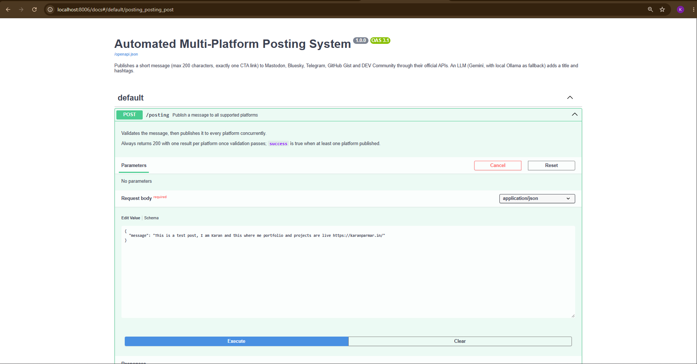
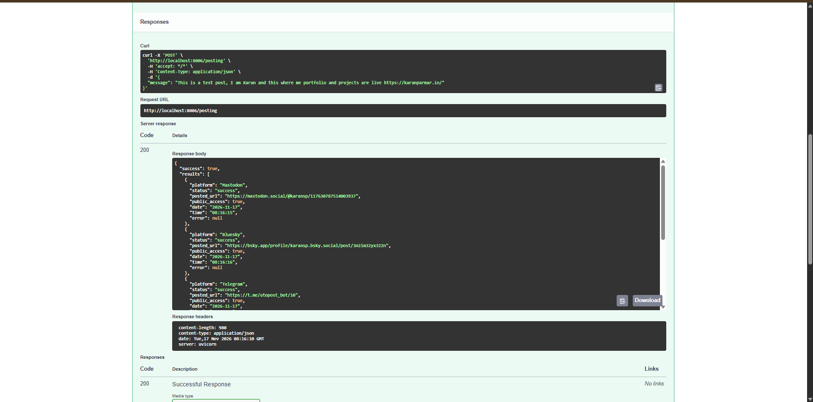
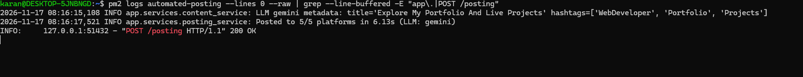
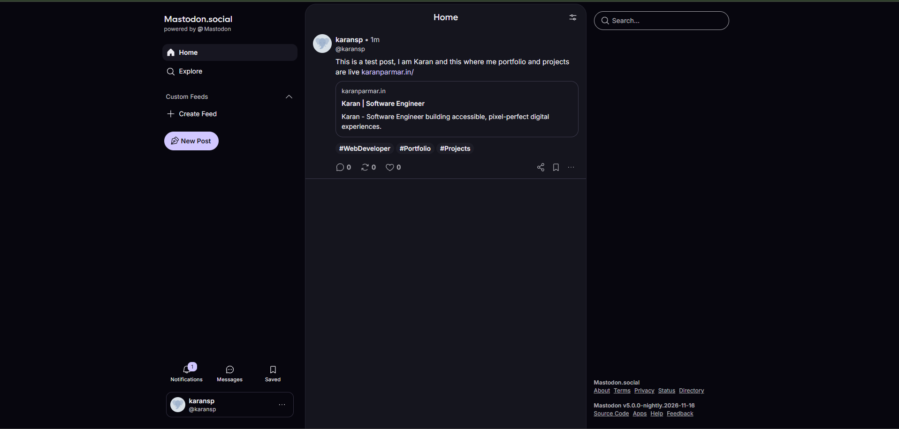
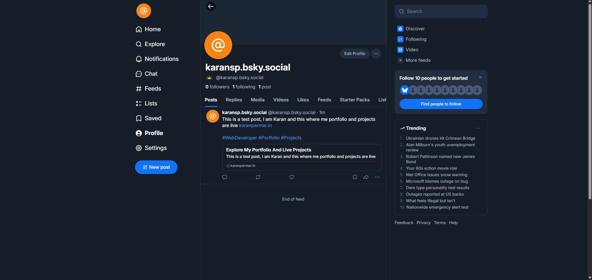
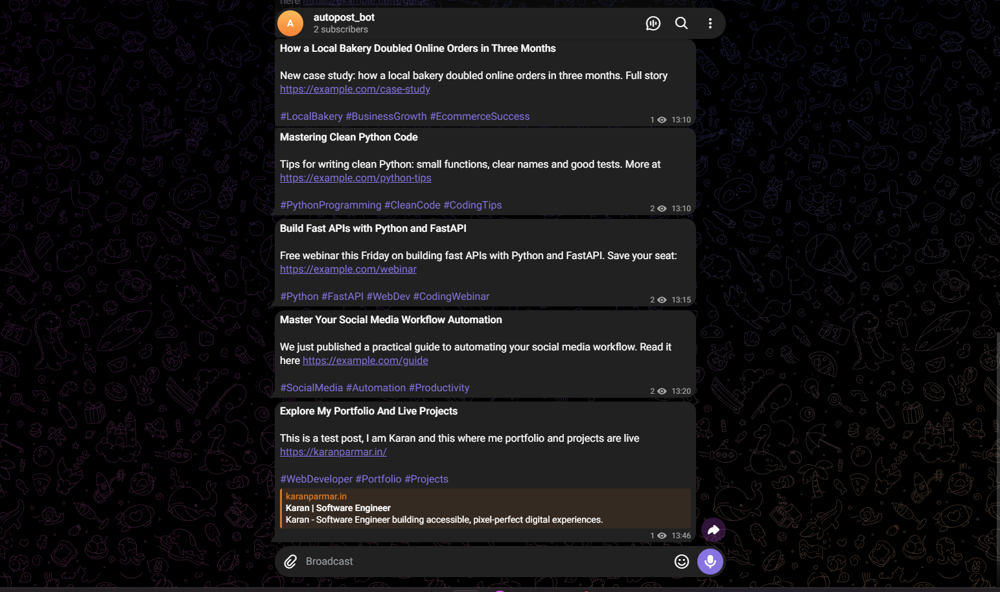
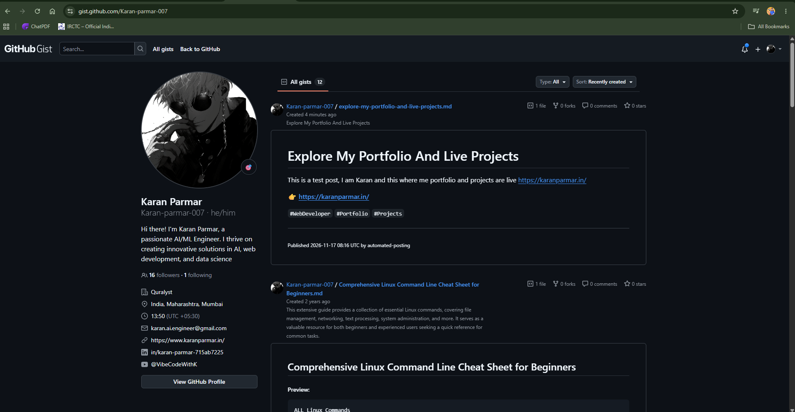
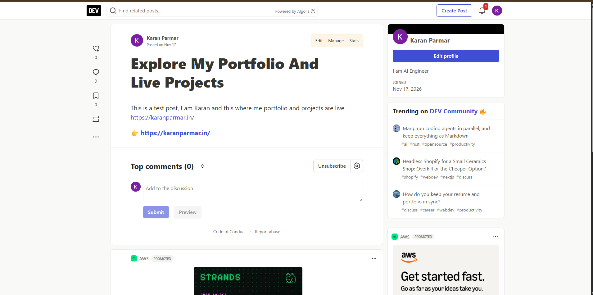

# Automated Multi-Platform Posting System

A FastAPI service that takes one short message (max 200 characters, exactly one CTA link) and
publishes it **automatically and concurrently** to five third-party platforms through their
official APIs. An LLM (Google Gemini, with a local Ollama model as fallback) adds a title and
hashtags to each post without ever changing the message or its link.

| # | Platform | API used | Posted URL | Public check |
|---|---|---|---|---|
| 1 | **Mastodon** | `POST /api/v1/statuses` ([docs](https://docs.joinmastodon.org/methods/statuses/#create)) | `https://mastodon.social/@user/<id>` | anonymous GET of the post |
| 2 | **Bluesky** | AT Protocol `com.atproto.server.createSession` + `com.atproto.repo.createRecord` ([docs](https://docs.bsky.app/docs/advanced-guides/posts)) | `https://bsky.app/profile/<handle>/post/<rkey>` | public AppView `app.bsky.feed.getPostThread` |
| 3 | **Telegram** | Bot API `sendMessage` to a public channel ([docs](https://core.telegram.org/bots/api#sendmessage)) | `https://t.me/<channel>/<message_id>` | from API response (public channel username) |
| 4 | **GitHub Gist** | `POST /gists` ([docs](https://docs.github.com/en/rest/gists/gists#create-a-gist)) | `https://gist.github.com/<user>/<id>` | anonymous GET of the gist |
| 5 | **DEV Community** | Forem API v1 `POST /api/articles` ([docs](https://developers.forem.com/api/v1)) | `https://dev.to/<user>/<slug>` | anonymous GET of the article |

**LLM providers:** [Gemini `generateContent`](https://ai.google.dev/api/generate-content) with a JSON schema
(structured output) → fallback to local [Ollama `/api/chat`](https://docs.ollama.com/api/chat)
(`qwen3.5:4b`) → fallback to the plain message.

---

## How it works

```
POST /posting {"message": "..."}
   │
   ├─ 1. Validation (Pydantic)          → 422 with clear errors if invalid
   │
   ├─ 2. ContentService                 → Gemini → Ollama → fallback
   │      title + hashtags only;           (never blocks posting)
   │      message & link are never changed
   │
   ├─ 3. asyncio.gather over all platforms, one shared pooled HTTP client
   │      ├─ Mastodon      ├─ Bluesky      ├─ Telegram
   │      ├─ GitHub Gist   └─ DEV Community
   │      each one: publish → timestamp → verify public access
   │      a failure in one platform never affects the others
   │
   └─ 4. 200 {"success": <any succeeded>, "results": [one entry per platform]}
```

### Design decisions

- **Platform isolation.** `BasePlatform.publish()` wraps every integration and *never raises*: auth
  errors, rate limits, timeouts, network errors and unexpected exceptions all become a `failed`
  result with a readable `error`. `asyncio.gather(..., return_exceptions=True)` adds a second safety net.
- **Concurrency.** All platforms are called in parallel, so total time ≈ the slowest platform, not the sum.
- **One pooled HTTP client** (created in the FastAPI lifespan) reuses TLS connections across requests.
- **The LLM never rewrites the message.** It only adds metadata (title, hashtags), so the CTA link
  can't be broken or hallucinated. The output is constrained by a JSON schema, then cleaned
  (letters/digits-only hashtags, de-duplicated, max 4; a title containing a URL is rejected).
- **Platform-specific formatting.**
  - *Bluesky* doesn't auto-detect links. The code sends rich-text **facets** with UTF-8 byte offsets,
    plus a link card (`app.bsky.embed.external`).
  - *Telegram* uses explicit **entities** (UTF-16 offsets) instead of Markdown, so there are no escaping bugs.
  - Hashtags are only appended while they fit the platform limit (Mastodon 500, Bluesky 300, Telegram 4096).
  - *DEV* tags are converted to its lowercase-alphanumeric format.
- **Real public-access verification.** After posting, each URL is fetched **without credentials**.
  - `bsky.app` returns 200 for any path, so Bluesky is verified via its public API.
  - `t.me` is blocked or unreliable on many networks, so Telegram visibility comes from the API
    response (a channel with a public username).
- **Security.** Credentials only come from environment variables, and `.env` is git-ignored.
  Configured secrets are scrubbed from every error message. httpx request logging is silenced
  because the Telegram token is part of its URL.
- **Fail fast on bad config.** An invalid `TIMEZONE` or unknown LLM provider stops the app at startup.
  A platform with missing credentials is reported as `not configured` rather than crashing.

---

## Project structure

```
automated-posting/
├── app/
│   ├── main.py                    # FastAPI app, POST /posting, 422 handler, lifespan (shared HTTP client)
│   ├── schemas.py                 # Request/response models + input validation
│   ├── config.py                  # Settings from environment / .env (pydantic-settings)
│   ├── platforms/
│   │   ├── __init__.py            # PLATFORM_CLASSES registry — add new integrations here
│   │   ├── base.py                # BasePlatform: error handling, timestamps, public-access check
│   │   ├── mastodon.py
│   │   ├── bluesky.py
│   │   ├── telegram.py
│   │   ├── github_gist.py
│   │   └── devto.py
│   └── services/
│       ├── posting_service.py     # Concurrent fan-out to all platforms
│       └── content_service.py     # LLM enrichment (Gemini → Ollama → fallback)
├── tests/test_posting.py          # 49 tests, all HTTP mocked with respx
├── scripts/run_scenarios.py       # live end-to-end scenarios against real APIs (creates real posts)
├── docs/
│   ├── REQUIREMENTS.md            # The assignment brief
│   ├── test-runs/                 # saved requests, responses and logs from live runs
│   └── screenshots/               # Swagger, response, logs and one post per platform
├── .env.example
├── pyproject.toml                 # ruff + pytest config
├── requirements.txt
└── README.md
```

---

## Setup

**Requirements:** Python 3.11+. Ollama is optional; it's only used if Gemini fails.

```bash
git clone <this-repo-url>
cd automated-posting

python3 -m venv .venv
source .venv/bin/activate          # Windows: .venv\Scripts\activate
pip install -r requirements.txt

cp .env.example .env               # then fill in the credentials below
```

### Getting credentials

| Variable(s) | Where to get it |
|---|---|
| `MASTODON_ACCESS_TOKEN` | mastodon.social → Preferences → Development → New application → scope `write:statuses` → "Your access token" |
| `BLUESKY_HANDLE`, `BLUESKY_APP_PASSWORD` | bsky.app → Settings → Privacy and security → App passwords |
| `TELEGRAM_BOT_TOKEN`, `TELEGRAM_CHANNEL` | @BotFather → `/newbot`; create a **public** channel and add the bot as admin with "Post Messages" |
| `GITHUB_TOKEN` | github.com/settings/personal-access-tokens → fine-grained token → Account permissions → **Gists: Read and write** |
| `DEVTO_API_KEY` | dev.to/settings/extensions → "DEV Community API Keys" |
| `GEMINI_API_KEY` (optional) | aistudio.google.com/apikey (free tier) |
| Ollama (optional) | Install Ollama, then `ollama pull qwen3.5:4b` |

---

## Run

```bash
uvicorn app.main:app --host 0.0.0.0 --port 4000
```

- Swagger UI: http://localhost:4000/docs
- Health check: http://localhost:4000/health

## API

### `POST /posting`

```bash
curl -X POST http://localhost:4000/posting \
  -H "Content-Type: application/json" \
  -d '{"message": "Check out our latest business platform and grow your online visibility. https://example.com"}'
```

#### Input validation (HTTP 422)

| Rule | Example error |
|---|---|
| Not empty | `Message must not be empty.` |
| Max 200 characters | `Message must not exceed 200 characters (got 214).` |
| Exactly one link | `Message must contain exactly one CTA link (found 2).` |
| Link must be http(s) | `CTA link must start with http:// or https:// (got 'www.example.com').` |
| Valid URL syntax | `CTA link is not a valid URL: '...'.` |
| Body shape / type | `Field required`, `Input should be a valid string` |
| Real public domain (no localhost/IPs, no invalid characters such as `exa_mple!.com`, valid TLD) | `CTA link must use a valid public domain name (got 'https://exa_mple!.com').` |

```json
{
  "success": false,
  "errors": [{ "field": "message", "message": "Message must contain exactly one CTA link (found 2)." }]
}
```

#### Success (HTTP 200): live run on 2026-11-17

Request:

```bash
curl -X POST http://localhost:4000/posting \
  -H "Content-Type: application/json" \
  -d '{"message": "This is a test post, I am Karan and this where me portfolio and projects are live https://karanparmar.in/"}'
```

Response (`date`/`time` use the `TIMEZONE` setting, default UTC). The first two entries are copied
exactly from the Swagger response in [`success_response.png`](docs/screenshots/success_response.png);
the other three entries have the same shape.

```json
{
  "success": true,
  "results": [
    {
      "platform": "Mastodon",
      "status": "success",
      "posted_url": "https://mastodon.social/@karansp/117630787514003937",
      "public_access": true,
      "date": "2026-11-17",
      "time": "08:16:15",
      "error": null
    },
    {
      "platform": "Bluesky",
      "status": "success",
      "posted_url": "https://bsky.app/profile/karansp.bsky.social/post/3n2im32yx322n",
      "public_access": true,
      "date": "2026-11-17",
      "time": "08:16:16",
      "error": null
    }
  ]
}
```

Posts created by this request:

| Platform | Posted URL | Public |
|---|---|---|
| Mastodon | https://mastodon.social/@karansp/117630787514003937 | ✅ |
| Bluesky | https://bsky.app/profile/karansp.bsky.social/post/3n2im32yx322n | ✅ |
| Telegram | https://t.me/utopost_bot/10 | ✅ |
| GitHub Gist | https://gist.github.com/Karan-parmar-007/3d70ae7b4904cea11fa2ae14d96fe7f0 | ✅ |
| DEV Community | https://dev.to/karan_parmar_0014/explore-my-portfolio-and-live-projects-4d1n | ✅ |

Server log for the same request ([`logs.png`](docs/screenshots/logs.png)):

```
2026-11-17 08:16:15,108 INFO app.services.content_service: LLM gemini metadata: title='Explore My Portfolio And Live Projects' hashtags=['WebDeveloper', 'Portfolio', 'Projects']
2026-11-17 08:16:17,521 INFO app.services.posting_service: Posted to 5/5 platforms in 6.13s (LLM: gemini)
INFO:     127.0.0.1:51432 - "POST /posting HTTP/1.1" 200 OK
```

`success` is `true` when at least one platform published.

#### Partial failure (HTTP 200): one platform fails, the rest still publish

From a live run with the Mastodon token deliberately invalid ([`docs/test-runs/02-fail-mastodon.json`](docs/test-runs/02-fail-mastodon.json)):

```json
{
  "platform": "Mastodon",
  "status": "failed",
  "posted_url": null,
  "public_access": false,
  "date": null,
  "time": null,
  "error": "Authentication failed: The access token is invalid"
}
```

The other four platforms in that response are `success`, and the top-level `success` is `true`.

## Tests

```bash
pytest -q          # 49 tests, no network access needed (all HTTP mocked with respx)
ruff check .       # lint
```

The tests cover:
- every validation rule;
- success, authentication failure, rate limit and timeout for each platform;
- one platform failing while the others succeed;
- all five platforms succeeding together;
- UTF-8 (Bluesky) and UTF-16 (Telegram) offsets with emoji;
- LLM fallback (Gemini overloaded → Ollama; invalid JSON → plain message);
- secret scrubbing in error messages.

## Live test results

Every scenario below ran against the **real** platform APIs. Failures were triggered by overriding
one credential with an invalid value through an environment variable (env vars take priority over
`.env`). Each request, response and server log is saved in [`docs/test-runs/`](docs/test-runs/).
The test posts were deleted afterwards, so links inside those files no longer resolve.

| Scenario | Broken on purpose | Result |
|---|---|---|
| [`00-validation-errors`](docs/test-runs/00-validation-errors.json) | 12 invalid inputs | All rejected with **422**; nothing posted |
| [`01-all-success`](docs/test-runs/01-all-success.json) | nothing | **5/5** published, all publicly accessible |
| [`02-fail-mastodon`](docs/test-runs/02-fail-mastodon.json) | Mastodon token | Mastodon `failed` (*The access token is invalid*); other **4/4 published** |
| [`03-fail-bluesky`](docs/test-runs/03-fail-bluesky.json) | Bluesky app password | Bluesky `failed` (*AuthenticationRequired: Invalid identifier or password*) **and** DEV `failed` (rate limit, see below); other **3 published** |
| [`04-fail-telegram`](docs/test-runs/04-fail-telegram.json) | Telegram bot token | Telegram `failed` (*Unauthorized*) **and** DEV `failed` (rate limit); other **3 published** |
| [`05-fail-github`](docs/test-runs/05-fail-github.json) | GitHub token | Gist `failed` (*Bad credentials*) **and** DEV `failed` (rate limit); other **3 published** |
| [`06-fail-devto`](docs/test-runs/06-fail-devto.json) | DEV API key | DEV `failed` (*unauthorized*); other **4/4 published** |
| [`09-devto-rate-limit`](docs/test-runs/09-devto-rate-limit.json) | Mastodon token (+ real DEV rate limit) | **Two failures at once**: Mastodon (401) and DEV (429, *retry after 300s*); other **3 published** |

The live runs show that:
- **every platform's own error message is passed through**, so it's clear what went wrong;
- **failures are isolated**: one or two platforms failing never stopped the others;
- **rate limits are reported, not retried**: DEV's `Retry-After: 300` is shown in the error
  instead of blocking the HTTP request for 5 minutes;
- **the validation tests found a real bug**: `https://exa_mple!.com` was first accepted, because
  Pydantic's `HttpUrl` follows the WHATWG URL standard, which allows `!` and `_` in hosts. A strict
  DNS hostname check (RFC 1123 labels, a valid TLD, no IPs) now rejects it, and regression tests were added.

To re-run the scenarios (this **creates real public posts**; space DEV runs at least 5 minutes apart):

```bash
python scripts/run_scenarios.py 02-fail-mastodon
```

### Platform limits learned during testing

| Platform | Limit / behaviour | How the app handles it |
|---|---|---|
| DEV Community | One article per ~5 minutes; a brand-new account publishing several near-identical promotional articles through the API in a few minutes gets **flagged as spam** (read-only) | 429 is reported with `Retry-After`. Space posts out and use real links, not `example.com` |
| Telegram | `t.me` is blocked or unreliable on some networks | Public access is derived from the API response (a channel with a public username) |
| Telegram | Rejects link previews for invalid domains (`WEBPAGE_URL_INVALID`) | Prevented by strict URL validation |
| Bluesky | Links and hashtags are not auto-detected; text limit is 300 | Facets with UTF-8 byte offsets; hashtags only added while they fit |
| Bluesky | `createSession` is rate limited | Session cached for 1 hour, with automatic re-login on `ExpiredToken` |
| Gemini | Occasional `503 high demand` | Automatic fallback to local Ollama, then to the plain message |

## Screenshots

**Swagger UI: `POST /posting`** ([`post_creation.png`](docs/screenshots/post_creation.png))



**Response: 5/5 platforms succeeded** ([`success_response.png`](docs/screenshots/success_response.png))



**Server log** ([`logs.png`](docs/screenshots/logs.png))



**The published posts**

| Mastodon | Bluesky |
|---|---|
|  |  |
| **Telegram** (bold LLM title, link preview, clickable hashtags) | **GitHub Gist** (Markdown file) |
|  |  |

**DEV Community article**



## Adding a new platform

1. Create `app/platforms/<name>.py` with a subclass of `BasePlatform` that implements
   `is_configured()` and `_publish()`. `_publish()` returns a `PublishedPost` or raises `PlatformError`.
2. Add it to `PLATFORM_CLASSES` in `app/platforms/__init__.py`.
3. Add its settings to `app/config.py` and `.env.example`.

Error handling, timestamps, public-access checks and concurrency are inherited from the base class.
